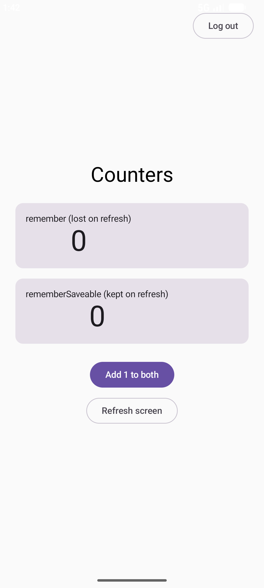
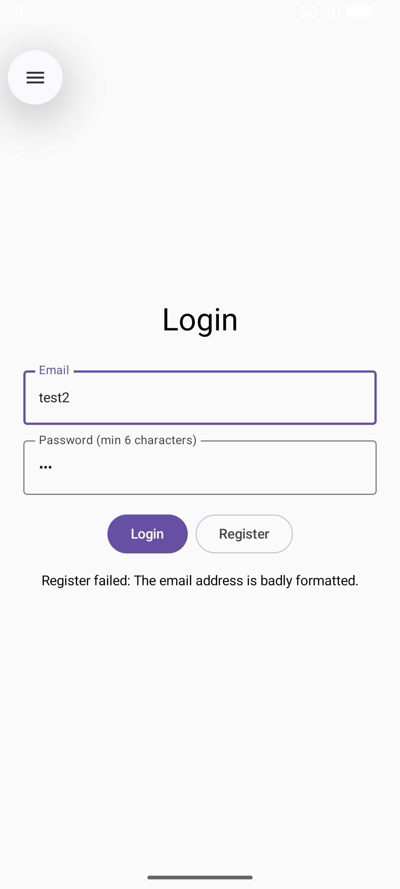
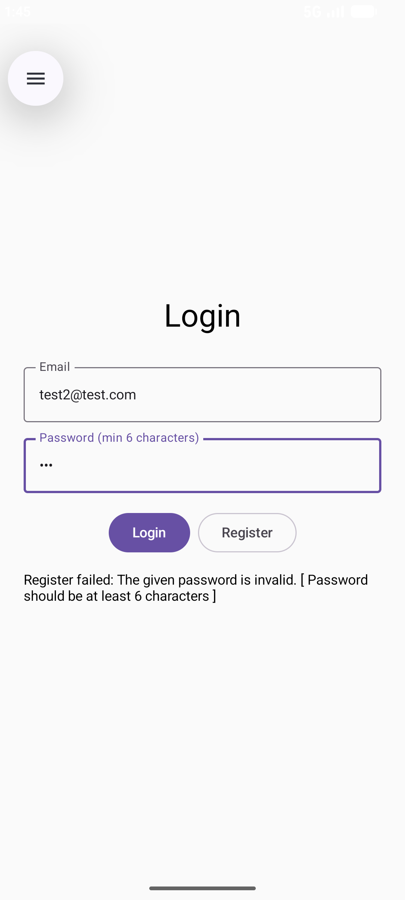
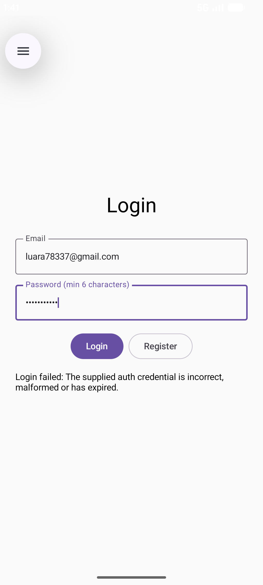
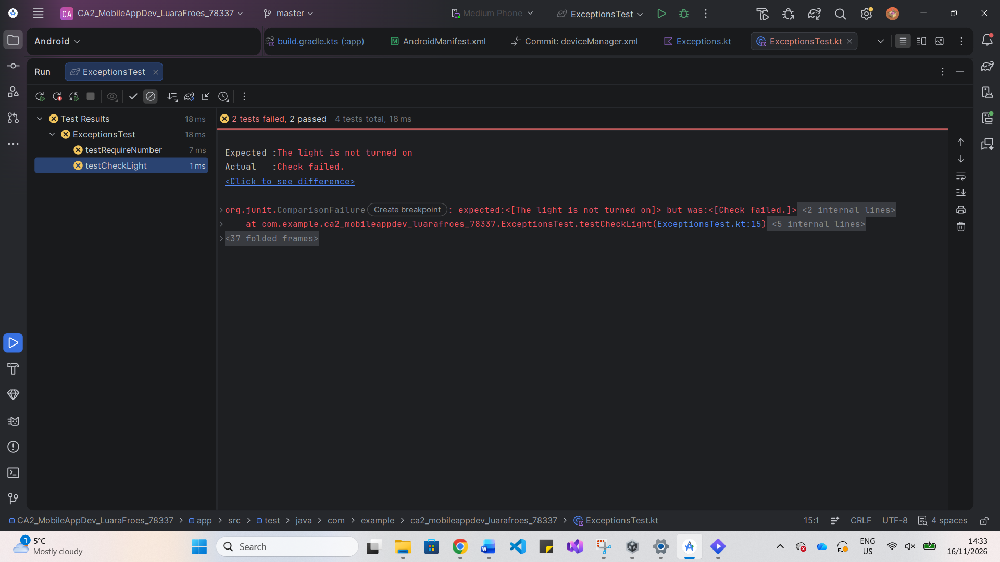
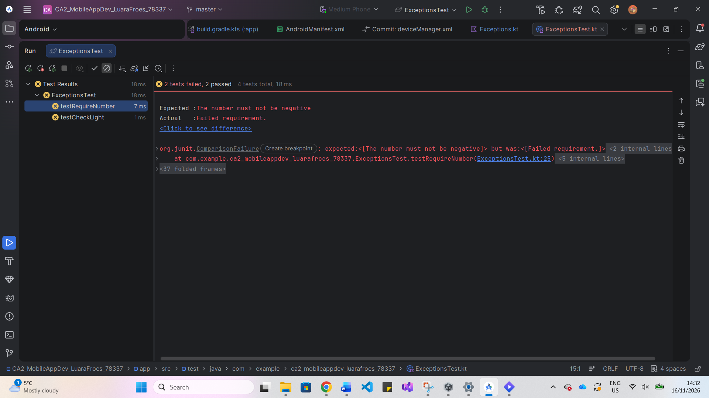

# Android Mobile App Development – CA2

**Student:** Luara Froes  
**Student ID:** 78337

## Project Overview

This project was developed as part of the Android Mobile App Development module. It demonstrates Android application development using Kotlin and Jetpack Compose, including input validation, error handling and custom exceptions.

## Screenshots

### 1. Application Functionality

**Counter Working**

### 2. Input Validation

**Invalid Email**

**Password Too Short**

### 3. Error Handling

**Incorrect Password**

**Incorrect Password – Additional Test**

### 4. Exception Testing

**Check Light Test**

**Number Validation Test**

## Technologies Used

- Kotlin
- Android Studio
- Jetpack Compose
- Firebase Authentication
- JUnit

## Testing

The application includes tests for input validation and exception handling, including:

- Email validation.
- Password length validation.
- Incorrect password handling.
- `check()` to validate program state.
- `require()` to validate arguments.
- Custom `WordTooLongException` for words exceeding 10 characters.

## Author

**Luara Froes – 78337**
