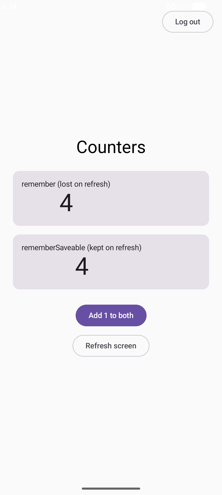
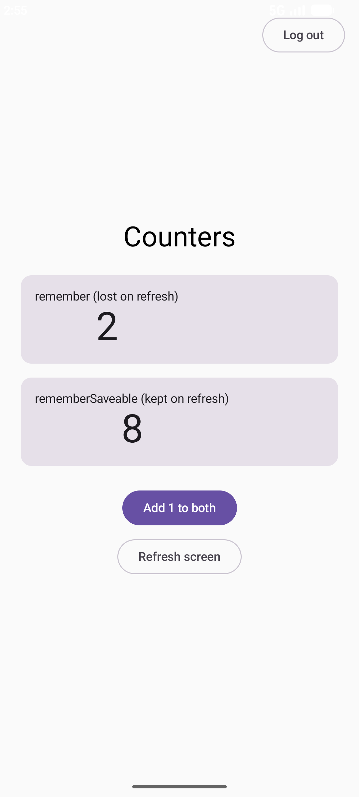

# Android Mobile App Development – CA2

**Student:** Luara Froes  
**Student Number:** 78337

## 1. Project Overview

This project was developed as part of the Android Mobile App Development module. It demonstrates Android development using Kotlin and Jetpack Compose, including user input validation, error handling, exception handling, counters and state management.

The application also uses Firebase Authentication for user authentication.

## 2. Technologies Used

- Kotlin
- Android Studio
- Jetpack Compose
- Firebase Authentication
- JUnit

## 3. Application Screenshots

### Counter Functionality

**Counters Working**

**Counters After Refresh**

### Input Validation

**Invalid Email**

**Password Too Short**

### Error Handling

**Incorrect Password**

**Additional Incorrect Password Test**

### Exception Testing

**Check Light Test**

**Number Validation Test**

## 4. Counter Testing – remember() vs rememberSaveable()

The application demonstrates two different ways of managing UI state in Jetpack Compose.

- **remember():** Keeps the counter value during recomposition but resets when the screen is recreated.
- **rememberSaveable():** Preserves the counter value when the screen is recreated, such as after an activity refresh.

The screenshots demonstrate the difference between these two methods.

## 5. Exception Handling and Testing

The project includes examples of exception handling using Kotlin.

The tests demonstrate:

- Using `check()` to verify a condition.
- Using `require()` to validate an argument.
- Creating and throwing a custom exception.
- Testing valid and invalid inputs.
- Checking expected exceptions using JUnit.

## 6. Authentication and Validation

The application includes Firebase Authentication and input validation.

The validation examples cover:

- Invalid email addresses.
- Passwords that are too short.
- Incorrect password errors.

## 7. Author

**Luara Froes – 78337**

BSc in Science in Computing & Multimedia  
Dorset College
